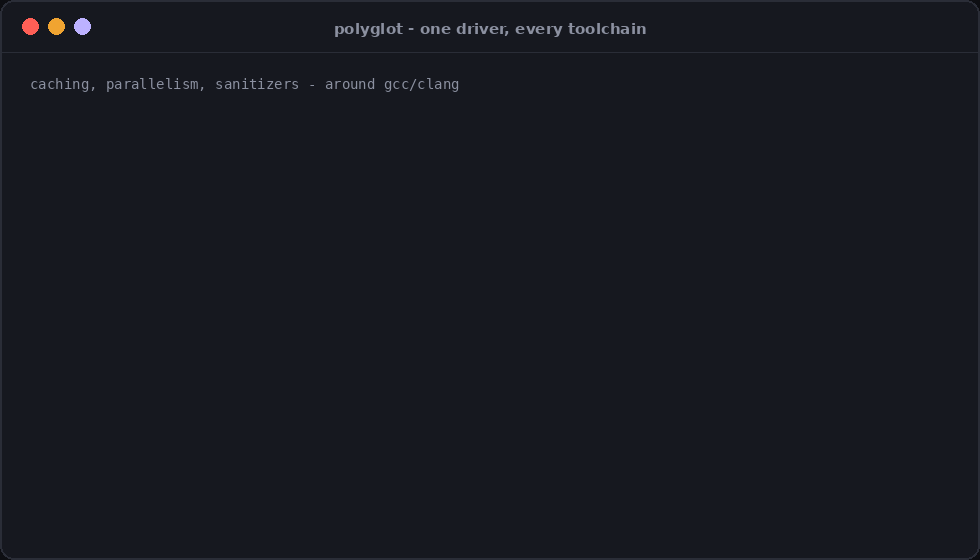
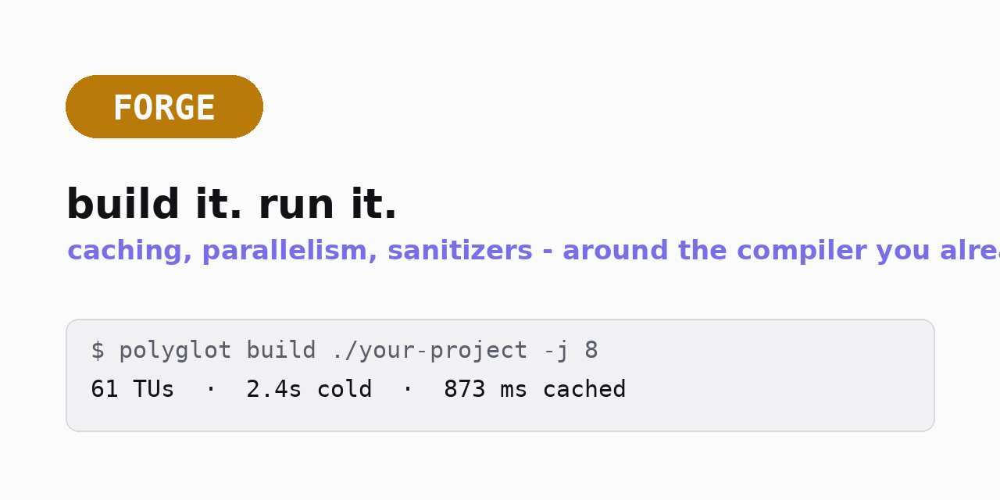
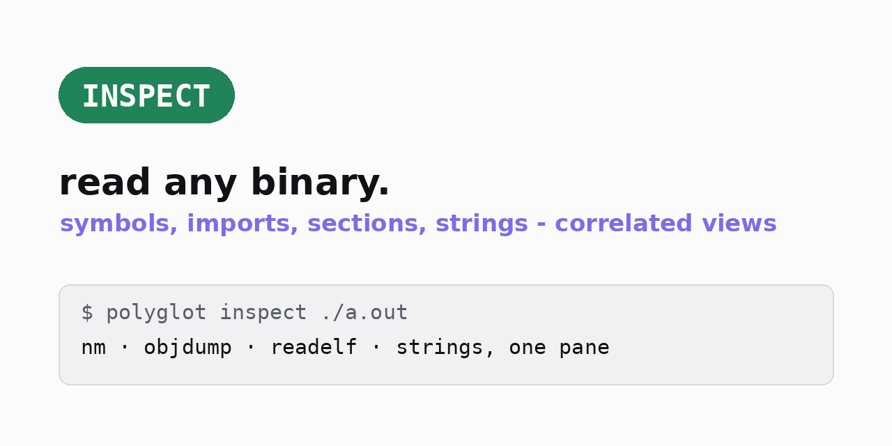
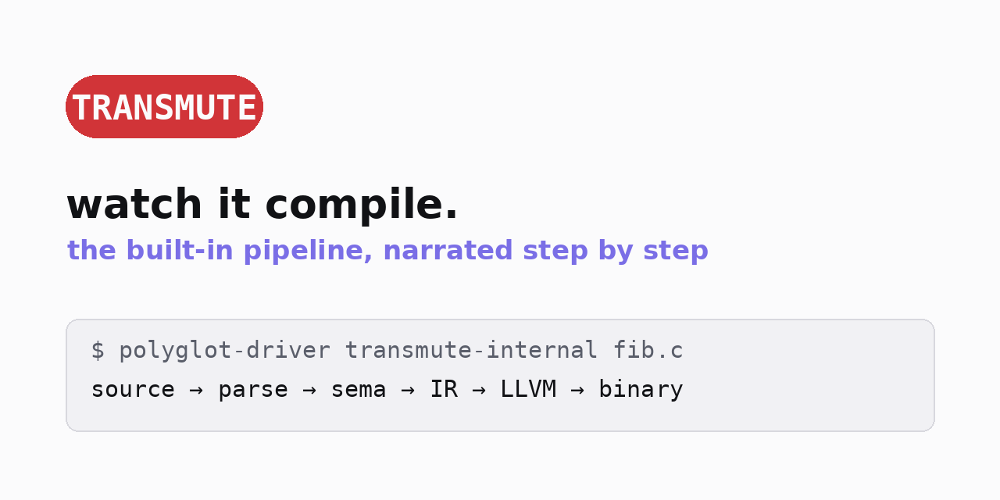
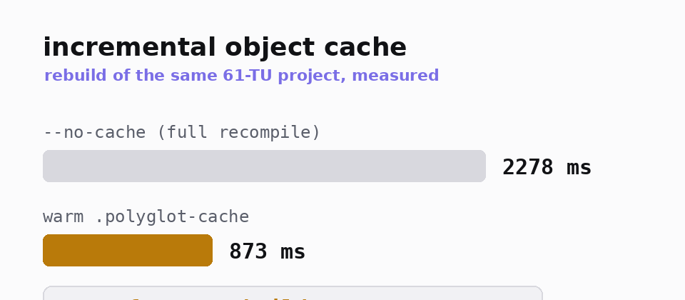
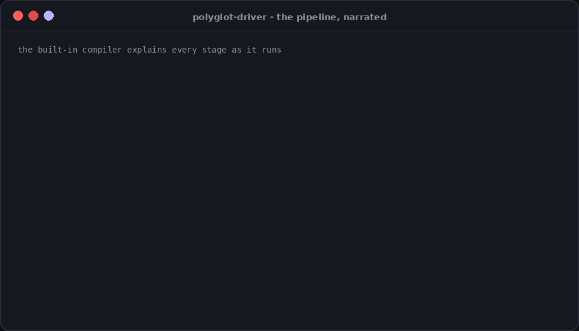
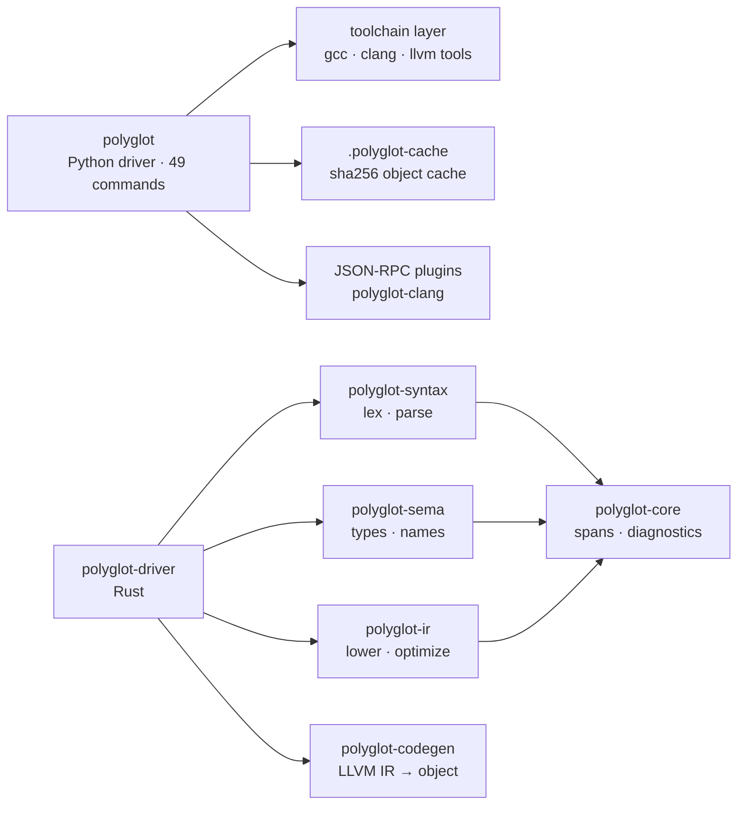

<div align="center">
  <picture>
    <source media="(prefers-color-scheme: dark)" srcset="docs/logo.svg">
    
  </picture>
  <h1>polyglot</h1>
  <p><strong>One driver for every C/C++ toolchain — plus a built-in compiler that shows its work</strong></p>
  <p>Cached parallel builds · binary inspection · cross-compilation · a narrated source-to-binary pipeline</p>
  <p>
    <a href="https://github.com/RXVEN-1907/polyglot-compiler/actions/workflows/ci.yml"></a>
    <a href="https://github.com/RXVEN-1907/polyglot-compiler/releases/latest"></a>
    <a href="https://github.com/RXVEN-1907/polyglot-compiler/releases/latest"></a>
    <a href="LICENSE"></a>
    <a href="https://www.python.org"></a>
    <a href="https://www.rust-lang.org"></a>
  </p>
</div>

---

**You already have the toolchains — gcc, clang, llvm-nm, objdump, gdb,
clang-tidy. What you don't have is one command that uses them all
together.** `polyglot` is that command: a zero-setup driver that wraps
every C/C++ toolchain on your machine with cached parallel builds, one
vocabulary for binary inspection, cross-compilation targets, and
machine-readable output everywhere. And because a driver that only
delegates would be half a story, the repo also ships a **built-in
compiler pipeline** — lexer → parser → semantic analysis → IR → LLVM —
that can compile a C subset end to end and narrate every step.

No daemon. No Docker. The Python driver needs only the standard library
plus `toml`; the Rust driver compiles with zero system dependencies.

<div align="center"></div>

*Real output: a 61-TU project, cold then warm — unchanged translation
units never recompile.*

<details>
<summary><strong>Contents</strong></summary>

- [Three workflows](#three-workflows)
- [Quickstart](#quickstart)
- [Builds: caching, parallelism, sanitizers](#builds-caching-parallelism-sanitizers)
- [Binary inspection](#binary-inspection)
- [The built-in pipeline](#the-built-in-pipeline)
- [All 49 commands](#all-49-commands)
- [Plugins](#plugins)
- [How it compares](#how-it-compares)
- [CI/CD integration](#cicd-integration)
- [Releases](#releases)
- [FAQ](#faq)
- [Architecture](#architecture)

</details>

## Three workflows

<div align="center">
  <table><tr>
    <td align="center" width="33%">
      <picture>
        <source media="(prefers-color-scheme: dark)" srcset="docs/mode-forge.png">
        
      </picture>
    </td>
    <td align="center" width="33%">
      <picture>
        <source media="(prefers-color-scheme: dark)" srcset="docs/mode-inspect.png">
        
      </picture>
    </td>
    <td align="center" width="33%">
      <picture>
        <source media="(prefers-color-scheme: dark)" srcset="docs/mode-transmute.png">
        
      </picture>
    </td>
  </tr></table>
</div>

`build` compiles and runs, `inspect` reads what came out, `transmute`
shows what happened in between — each one command.

## Quickstart

The Python driver is one pip-install away (stdlib + `toml`, nothing else):

```console
$ pipx install git+https://github.com/RXVEN-1907/polyglot-compiler
$ polyglot doctor          # reports every toolchain it found
```

or with the copy-install script (no pip involved):

```console
$ git clone https://github.com/RXVEN-1907/polyglot-compiler && cd polyglot-compiler
$ ./install.sh --yes
```

Then, immediately:

```console
$ polyglot build hello.c -o hello          # cached, parallel, -O2 default
$ polyglot run hello.c                     # build + execute in one step
$ polyglot emit-ir hello.c                 # LLVM IR (clang) or GIMPLE (gcc)
$ polyglot inspect ./hello                 # symbols, imports, strings
$ polyglot build ./my-project              # a directory with polyglot.toml
```

Prebuilt Rust binaries (`polyglot-driver`, the built-in-pipeline
compiler) ship on every [release](#releases) for Linux, Windows, and
macOS.

## Builds: caching, parallelism, sanitizers

`polyglot build` wraps gcc or clang and adds what they don't give you
out of the box:

<div align="center">
  <picture>
    <source media="(prefers-color-scheme: dark)" srcset="docs/cache-chart.png">
    
  </picture>
</div>

| what | how |
|---|---|
| **Incremental object cache** | sha256-keyed objects in `.polyglot-cache/`; unchanged TUs skip the compiler entirely |
| **Parallel per-TU builds** | `-j N`, one compile per core |
| **Sanitizers in one flag** | `--sanitize address,undefined,thread,memory,leak` |
| **Warnings as a level** | `--warn {none,default,all,extra,pedantic}` + `--werror` |
| **Cross targets, listed honestly** | `polyglot targets` shows the triple, its status, and the exact apt line to unlock it |
| **Static & shared libs** | `--static-lib` (ar rcs), `--shared` |
| **Raw passthrough** | `--cc-arg` for anything exotic |

Projects are a `polyglot.toml` away:

```toml
[[bin]]
name = "app"          # every TU under src/, linked into one binary

[[lib]]
name = "mathlib"
kind = "static"
sources = ["src/math.c"]
```

`polyglot build ./my-project` builds every `[[bin]]` and `[[lib]]`
target, in parallel, from cache. `polyglot init` scaffolds the layout.

## Binary inspection

One vocabulary for the binutils zoo — every command takes `--json`:

```console
$ polyglot nm ./hello              # symbol table (llvm-nm / nm)
$ polyglot objdump ./hello -d      # disassembly
$ polyglot readelf ./hello         # ELF/PE/Mach-O headers
$ polyglot strings ./hello         # printable strings
$ polyglot inspect ./hello         # correlated view: symbols + imports + strings, one pane
$ polyglot query ./hello main      # one symbol, every tool's answer at once
```

`inspect` and `query` correlate output across tools and cache it, so
asking five questions about one binary costs one tool pass. `diff-asm`
diffs the same source across optimization levels; `diagnose` compares
gcc's and clang's diagnostics on the same file.

## The built-in pipeline

The Rust workspace is a real, from-scratch compiler for a subset of C —
not a binding to someone else's: preprocessor → lexer → parser → name
resolution and type checking → IR with optimization passes → LLVM IR →
object files (via `llc`, linked with the system `cc`). Its *build*
needs no system LLVM — only its object emission touches `llc`.

<div align="center"></div>

`transmute-internal` narrates the whole journey step by step — the
command to reach for when you want to *see* compilation happen. The
`polyglot-ir` crate's passes and the JSON-RPC plugin protocol are
reusable crates with their own test suites.

## All 49 commands

| group | commands |
|---|---|
| **build & run** | `build` `run` `check` `watch` `bench` `clean` `init` `cache` |
| **inspection** | `nm` `objdump` `readelf` `size` `strings` `strip` `addr2line` `cxxfilt` `inspect` `query` |
| **compiler views** | `emit-ir` `emit-asm` `preproc` `deps` `explain-ir` `transmute` `diff-asm` `graph` |
| **quality** | `fmt` `tidy` `analyze` `fuzz` `secopt` `verify` `fixit` |
| **tuning** | `pgo` `mca` `recommend` `secopt` `diff-asm` |
| **cross & config** | `targets` `compile-commands` `lsp` `debug` `config` |
| **tools & meta** | `doctor` `version` `completions` `plugin` `preview` `repl` `jit` `diagnose` `stats` |

Every command: `--help` documents its flags, most accept `--json`, all
respect [`NO_COLOR`](https://no-color.org). The full reference:
[`docs/reference/cli.md`](docs/reference/cli.md).

## Plugins

Compilers talk JSON-RPC 2.0 over stdio. `plugins/polyglot-clang` ships
as the reference plugin (Rust, ~200 lines); `polyglot plugin
install/list/remove` manages more, and `build --plugin` routes a
compile through one.

```console
$ polyglot plugin list
NAME            VERSION  KIND     PATH
polyglot-clang  0.3.0    builtin  .../polyglot-clang
```

## How it compares

| dimension | polyglot | ccache | bear | Compiler Explorer |
|---|---|---|---|---|
| primary job | drive + inspect + explain | cache compiles | generate compile_commands.json | explore IR/asm in a browser |
| object cache | built-in, sha256 | its whole point | none | none |
| binary inspection | 10 commands + correlated views | none | none | none |
| narrated pipeline | `transmute`, step by step | none | none | side-by-side, web only |
| install | one binary-free pip package | system package | system package | hosted / docker |

ccache is the cache king — polyglot's cache is for when you also want
the inspection, the IR views, and the pipeline in the same CLI.

## CI/CD integration

```yaml
# GitHub Actions: build with caching, then export a clangd database
- run: pipx install git+https://github.com/RXVEN-1907/polyglot-compiler
- run: polyglot build ./src -o app -j 4 --warn extra --werror
- run: polyglot compile-commands ./src -o compile_commands.json
```

`compile-commands` keeps clangd/IDE indexing in sync with the same
flags the build used.

## Releases

Tag a version and CI builds the Rust driver for Linux (x86-64
glibc/musl, aarch64, armv7, riscv64, s390x, loongarch64), Windows
(x86-64 + ARM64), and macOS (Apple silicon, Intel, universal2), plus
the `polyglot-clang` plugin binary — each archive checksummed. The
Python driver needs no binary: `pipx` or `install.sh` is the whole
install.

## FAQ

<details>
<summary><strong>Does it replace gcc/clang?</strong></summary>

No — it drives them. Your system compiler does the compiling; polyglot
adds caching, parallelism, uniform flags, inspection, and output
formats. The built-in pipeline is the one place polyglot compiles C
itself (a teaching-grade subset), clearly labeled.
</details>

<details>
<summary><strong>What does the driver need installed?</strong></summary>

Any one C compiler (gcc or clang) to be useful. Each inspection command
degrades gracefully and `polyglot doctor` tells you exactly what's
missing and the apt/brew line to fix it. The Rust driver's default
build needs no system LLVM at all.
</details>

<details>
<summary><strong>Where does state live?</strong></summary>

`.polyglot-cache/` in your project (delete it and the cache forgets)
plus `~/.polyglot/` for plugins and the inspection cache. No config
file is required.
</details>

<details>
<summary><strong>Is the built-in compiler production-grade?</strong></summary>

No — and the repo doesn't pretend otherwise. It handles a useful subset
of C (functions, structs, pointers, control flow) end to end with a
full test suite; production builds go through gcc/clang. Its job is to
make the pipeline legible.
</details>

## Architecture



Two front doors, one repo: the Python driver wraps your toolchains;
the Rust driver *is* one. Full map with a paragraph per crate:
[`docs/ARCHITECTURE.md`](docs/ARCHITECTURE.md).

## Documentation

[`docs/index.md`](docs/index.md) ·
[`getting-started/`](docs/getting-started/) ·
[`docs/reference/cli.md`](docs/reference/cli.md) ·
[`docs/ARCHITECTURE.md`](docs/ARCHITECTURE.md) ·
[`docs/user-guide/`](docs/user-guide/) ·
[`docs/API_REFERENCE.md`](docs/API_REFERENCE.md)

## Contributing

CI gates formatting, clippy (`-D warnings`, all targets), both test
suites, the audit, and a strict mkdocs build. Add a command to
`polyglot_lib/commands/`, a pass to `polyglot-ir`, or pick something
from the tracker — see [CONTRIBUTING.md](CONTRIBUTING.md).

## License

MIT — see [LICENSE](LICENSE).
